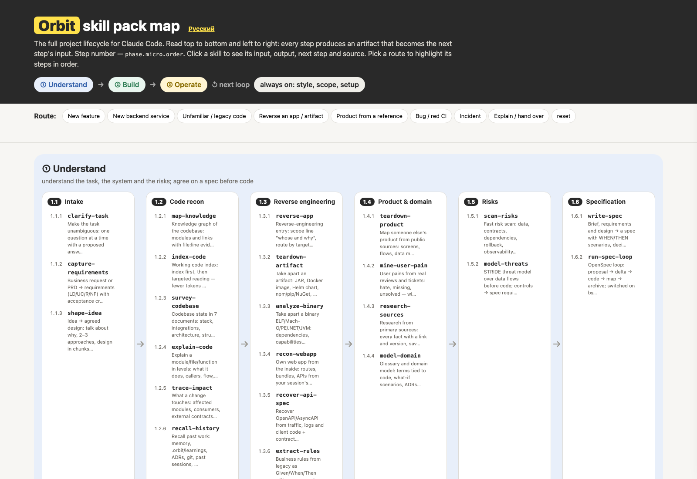

# Orbit Map — project maps & diagrams for Claude Code

[](#install)
[](LICENSE)

Two focused agent skills that turn a codebase or a plan into a picture people actually use:

- **`project-map`** — an interactive **one-file HTML project map**: phases, numbered steps in reading order, transitions, and links from every block to the exact file in the repo. Opens with a double click, publishes as a static page, works offline.
- **`project-diagram`** — **static SVG/PNG diagrams** of phases and steps for slides, docs and READMEs (blueprint and paper themes).

Both skills are part of the full **Orbit** skill pack — 89 skills in one pipeline
(Understand → Build → Operate) with shared `.orbit/` artifacts:
**https://github.com/tojim00d/Orbit-skills**



## Install

Requires [Claude Code](https://claude.com/claude-code).

```bash
claude plugin marketplace add tojim00d/orbit-map
claude plugin install orbit-map@orbit-map
```

Restart Claude Code. The skills are available as `/orbit-map:project-map` and
`/orbit-map:project-diagram` — or just ask in words: *"build a project map of this repo"*.

From a local clone:

```bash
git clone https://github.com/tojim00d/orbit-map.git
cd orbit-map
./install.sh
```

For other agents (Codex, Qwen Code, Cursor, …):

```bash
./install.sh --skills-dir ~/.agents/skills
```

Then read [AGENTS.md](AGENTS.md).

## Use

**Interactive map.** "Make a project map of this repository, one HTML file, with links to the code." The map is built from `project-data.js` — a single data file per project — while the engine (`project-schema.js`, `project-view.js`, `build.py`) stays unchanged. See `plugins/orbit-map/skills/project-map/SKILL.md` for the data model and the build flow.

**Static diagram.** "Draw the phases and steps as an SVG for the architecture doc." `project-diagram` renders blueprint and paper themes from the same model.

The shipped example: open [`docs/index.html`](docs/index.html) (or the published demo) — the map of this pack itself.

## What is inside

```
orbit-map/
├── .claude-plugin/marketplace.json
├── plugins/orbit-map/
│   ├── .claude-plugin/plugin.json
│   └── skills/
│       ├── project-map/        SKILL.md, assets/ (engine + starters), example/
│       └── project-diagram/    SKILL.md, scripts/, example/ (PNG themes)
├── docs/                       demo page (the example map), GitHub Pages root
├── assets/                     preview image and badges
├── install.sh                  Claude Code plugin, or any agent's skills dir
└── scripts/validate.py         structure check for CI
```

## Compatibility

Native on Claude Code. The skills are plain `SKILL.md` folders, so Codex, Qwen Code,
Cursor and any Agent Skills loader can read them; `./install.sh --skills-dir` copies them
into an agent's skills directory. See [AGENTS.md](AGENTS.md).

## License and credits

MIT for this package. The map and diagram engines are Orbit's own work; sources and helper
licences are listed inside each skill and in the full pack's
[CREDITS.md](https://github.com/tojim00d/Orbit-skills/blob/main/CREDITS.md).

Part of Orbit: **https://github.com/tojim00d/Orbit-skills** · Site:
**https://tojim00d.github.io/Orbit-skills/**
