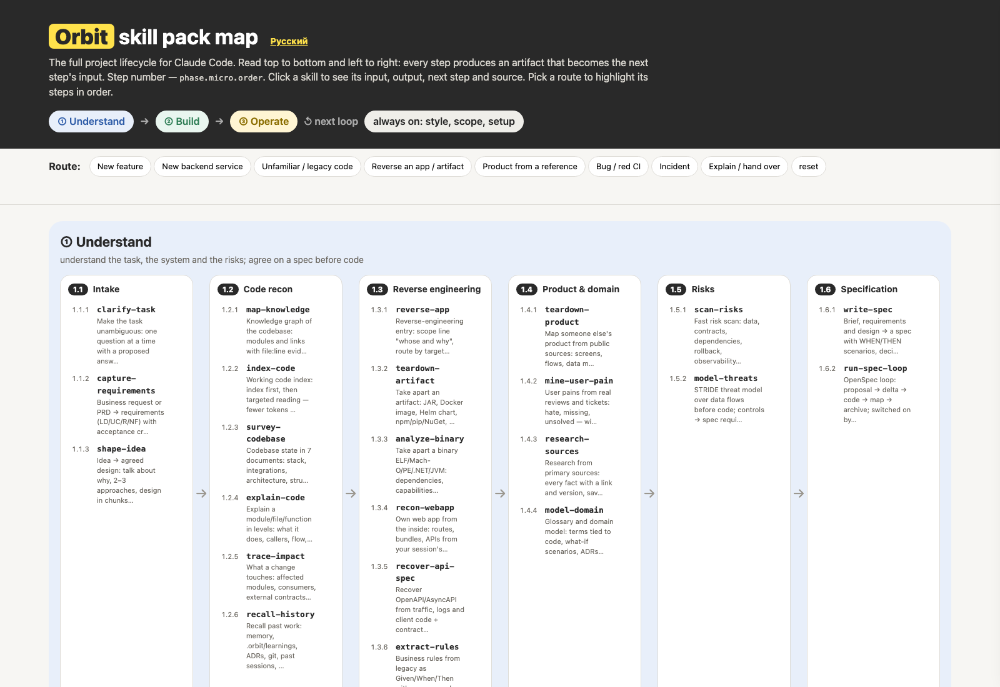

# Orbit Map — карты проектов и диаграммы для Claude Code

[](#установка)
[](LICENSE)

Два сфокусированных агентных скилла, которые превращают кодовую базу или план в картинку, которой реально пользуются:

- **`project-map`** — интерактивная **карта проекта одним HTML-файлом**: фазы, пронумерованные шаги в порядке чтения, переходы и ссылки из каждого блока на конкретный файл в репозитории. Открывается двойным кликом, публикуется как статическая страница, работает офлайн.
- **`project-diagram`** — **статичные SVG/PNG-диаграммы** фаз и шагов для слайдов, документации и README (темы blueprint и paper).

Оба скилла входят в полный пак **Orbit** — 89 скиллов в одном конвейере
(Разобраться → Разработать → Сопровождать) с общими артефактами `.orbit/`:
**https://github.com/tojim00d/Orbit-skills**



## Установка

Нужен [Claude Code](https://claude.com/claude-code).

```bash
claude plugin marketplace add tojim00d/orbit-map
claude plugin install orbit-map@orbit-map
```

Перезапусти Claude Code. Скиллы доступны как `/orbit-map:project-map` и
`/orbit-map:project-diagram` — или просто попроси словами: «построй карту проекта этого репозитория».

Из локальной копии:

```bash
git clone https://github.com/tojim00d/orbit-map.git
cd orbit-map
./install.sh
```

Для других агентов (Codex, Qwen Code, Cursor, …):

```bash
./install.sh --skills-dir ~/.agents/skills
```

Затем прочитай [AGENTS.md](AGENTS.md).

## Как пользоваться

**Интерактивная карта.** «Сделай карту проекта этого репозитория, один HTML-файл, со ссылками на код». Карта строится из `project-data.js` — одного файла данных на проект, — а движок (`project-schema.js`, `project-view.js`, `build.py`) не меняется. Модель данных и сборка — в `plugins/orbit-map/skills/project-map/SKILL.md`.

**Статичная диаграмма.** «Нарисуй фазы и шаги как SVG для архитектурного документа». `project-diagram` рендерит темы blueprint и paper из той же модели.

Пример: открой [`docs/index.html`](docs/index.html) (или опубликованное демо) — карта самого этого пака.

## Что внутри

```
orbit-map/
├── .claude-plugin/marketplace.json
├── plugins/orbit-map/
│   ├── .claude-plugin/plugin.json
│   └── skills/
│       ├── project-map/        SKILL.md, assets/ (движок + стартеры), example/
│       └── project-diagram/    SKILL.md, scripts/, example/ (PNG-темы)
├── docs/                       демо-страница (пример карты), корень GitHub Pages
├── assets/                     превью и бейджи
├── install.sh                  плагин Claude Code или папка скиллов любого агента
└── scripts/validate.py         проверка структуры для CI
```

## Совместимость

Нативно — Claude Code. Скиллы — обычные папки `SKILL.md`, поэтому Codex, Qwen Code, Cursor и любой загрузчик Agent Skills читают их; `./install.sh --skills-dir` копирует их в папку скиллов агента. См. [AGENTS.md](AGENTS.md).

## Лицензия и кредиты

MIT для этого пакета. Движки карты и диаграмм — собственная работа Orbit; источники и лицензии вспомогательных инструментов перечислены в каждом скилле и в
[CREDITS.md](https://github.com/tojim00d/Orbit-skills/blob/main/CREDITS.md) полного пака.

Часть Orbit: **https://github.com/tojim00d/Orbit-skills** · Сайт:
**https://tojim00d.github.io/Orbit-skills/**
